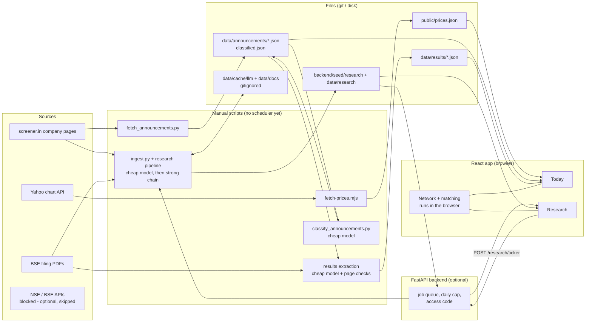

# FINN architecture

Legend: **Built** = in this repo and exercised; **Production plan** = intended, not built. Anything not marked "Production plan" exists in the code.

## 1. Data pipelines

All pipelines are scripts you run by hand; results are plain JSON files, some committed so the app works without a backend. There is no database, scheduler or queue service.

**Prices** — `scripts/fetch-prices.mjs` requests Yahoo's chart endpoint per ticker (`<TICKER>.NS`, 3 months, daily) and writes `public/prices.json` with a per-ticker `status` (`live` / `no_data` / `demo`) and `lastDate`. A failed ticker becomes `no_data`; synthetic series exist only behind `--demo`, which sets `demo: true`, and the app shows a banner. The app computes price/volume alerts in the browser from this file.

**Filings** — `backend/app/announcements.py` reads each ticker's screener.in company page (reusing the same page fetch as document ingestion) and keeps ticker, timestamp, headline, one-line detail and the BSE PDF link. Snapshots merge into `data/announcements/<TICKER>.json` and are de-duplicated on ticker + time + headline, so re-runs only add new items; `all.json` combines them. Screener exposes only the latest 5 per company. NSE/BSE clients exist behind `--exchanges` and are skipped after the first 403.
`classify_announcements.py` then classifies items into the 17 categories from the reference PDF with a priority and (for high/medium) a one-line summary, 25 headlines per call; items already in `classified.json` are not re-sent. For results filings, the PDF is downloaded (to the gitignored `data/results/pdfs/`), the pages that hold the results tables are selected, the cheap model extracts Revenue/EBITDA/PBT/PAT for the current, previous and year-ago quarter, and code verifies each figure's page and quote (below). Output: `data/results/<TICKER>.json`.

**Fundamentals** — `ingest.py` fetches a company's latest annual report and last four concall transcripts (links from its screener.in page), extracts text page by page (`pdfplumber`) into `data/docs/<TICKER>/`, and `run_research` runs: Stage 1 (per-document, chunked, quote-backed facts) → Stage 1b (structured facts with scope, period and value) → a guidance ledger and actuals ledger paired **in code** (verdicts like delivered/missed come from `ledger.py`, never from the model) → Stage 2 (one synthesis over the verified facts) → citation verification. Output: `data/research/<TICKER>.json`; `make_seed.py` copies finished results to `backend/seed/research` and `public/seed/research` so a fresh deploy has content.

**Profiles and the network** — the network (36 people) and three "people in filings" profiles are **invented** (`src/data/network.ts`); the company relationship graph (`src/data/graph.ts`) is illustrative. Nothing is fetched from any person-data source.

**Linking** — everything keys off the portfolio list (`src/data/portfolio.ts`). Renamed companies carry aliases (`TMPV`/`TMCV` both list the former name "Tata Motors"), so old employer histories still match.

### How names in filings are matched to people in the network

`src/lib/match.ts` + `src/lib/network.ts`, run in the browser, **no LLM**, and the steps are shown on each card ("Network match"):

1. **Recognise entities.** Companies: the filing's own ticker, plus any other portfolio company named in the text (by name, alias or word-bounded ticker). People: the filing's named person (if any), any person with a profile named in the text, any network contact named in the text.
2. **Match to contacts**, collecting a reason per link, each with a weight:
   - *worked at the company* (employer history incl. renamed companies) — 3;
   - *named in the filing* — 4;
   - *overlapped with a filing person* at the same employer (years computed from tenures) — 2 plus up to 2 more for longer overlap; same employer in different years — 1;
   - *same college* as the filing person — 1.5;
   - *supplier / customer / competitor of the company* via the illustrative graph — 1 / 1 / 0.75, tagged "illustrative (synthetic)".
3. **Rank** by summed weights plus a small bonus for relationship strength; reasons are listed strongest first, so a weak graph link is never the headline reason.

The Network tab reuses the same logic for Who to call (worked there → supplier/customer side → competitor), second-degree reach, the expertise map, keep-warm (contacts silent 60+ days whose old employer filed) and "quiet advantages".

## 2. Data security and privacy

**What is built**

- **No real personal data.** Every person in the network is invented. There are no user accounts, no sign-in, no cookies, and the app has no analytics.
- **The network is not private in this prototype — it is public and fake.** It is bundled into the frontend JavaScript, so any visitor can read it. That is acceptable only because it is synthetic. A real contact network must never be loaded this way.
- **Browser storage:** the access code (if the user types one) goes in `sessionStorage` (cleared when the tab closes); finished research results and one in-progress job id are cached in `localStorage` (no expiry; per browser).
- **Server storage:** `data/usage.json` (date + a count of analyses today), `data/jobs/<id>.json` (ticker, status, timestamps — no user identity), and research outputs about listed companies. Uvicorn's default access log records client IP addresses; the app code stores none. **No retention policy is implemented**: job files and logs stay until deleted by hand.
- **Spend protection on the one endpoint that costs money** (`POST /research/{ticker}`): viewing existing/seed research is free and never starts a job; analysing a new ticker needs the `X-Access-Code` header when `ACCESS_CODE` is set (compared with `hmac.compare_digest`); a global cap of `MAX_NEW_ANALYSES_PER_DAY` (default 3, per UTC day) with a clear 429; `MAX_QUEUED_JOBS`; re-running an existing analysis is refused unless an access code is configured and supplied, and a result younger than `REFRESH_COOLDOWN_MINUTES` is returned as-is; missing documents refund the cap slot. CORS is restricted to `ALLOWED_ORIGINS`. The Gemini key lives only in the server's environment (`.env` is git-ignored).
- **Honest limits:** one shared access code (no per-user identity or quota), a global rather than per-user cap, and file-based state.

**Production plan (not built)**

- **Consent and import:** contacts enter only through an investor-consented import (CRM / email / calendar via OAuth), with a consent record per source; no scraping of third-party profile sites.
- **Isolation:** per-user tenant; the network stored server-side, never in the client bundle; row-level access control so one user's data is unreachable by another; encrypted at rest and in transit; audit log of reads/exports.
- **Retention and deletion:** a stated retention period, deletion on request that removes derived data too, purge of inactive imports.
- **Access control:** real authentication (SSO/passwordless) replacing the shared code; per-user quotas; secrets in a managed secret store.

## 3. Use of LLMs

All calls go through one wrapper (`backend/app/llm.py`): Gemini REST, JSON output, temperature 0.

| Task | Model | Where |
|---|---|---|
| Announcement classification, priority, summary | cheap (`CHEAP_MODEL`, default `gemini-3.5-flash-lite`) | `announce_intel.py` |
| Results-table extraction | cheap | `announce_intel.py` |
| Research Stage 1 (per-document facts) and Stage 1b (structured facts) | cheap | `stage1.py`, `stage1b.py` |
| Research Stage 2 (synthesis: narrative, trajectory, bull/bear) | strong chain | `stage2.py` |
| Fetching, price alerts, network matching, guidance verdicts, all arithmetic | **no LLM** | code |

**Routing and fallback.** The strong chain is `STRONG_MODEL` → each `STRONG_MODEL_FALLBACKS` model → the cheap model last, so a run always completes. A non-final model gets `STRONG_RETRIES` retries (with back-off, honouring the server's retry delay) before the next model is tried; the last model gets the full `LLM_MAX_RETRIES`. A server-requested wait above `LLM_MAX_WAIT`, or a daily-quota error, fails fast instead of sleeping. The model actually used and whether it was a fallback are recorded in every output. Classification and results extraction use the same chain starting from the cheap model (the larger fallbacks are only reached if it keeps failing). Calls run strictly one at a time, at least `LLM_MIN_INTERVAL` seconds apart.

**What happened in practice.** The larger Gemini models were overloaded (503s, timeouts) during testing; the cheap model answered reliably. So the four committed research seeds (INFY, DEEPAKNTR, TITAN, TMPV) were generated with Stage 2 forced onto the cheap model, and `backend/.env.deploy.example` sets it as the Stage-2 model for hosting. The local `.env.example` still lists the larger model first.

**Caching.** Every call is cached on disk (`data/cache/llm`, git-ignored) under a key of model + prompt version + document hash + part + full prompt, so unchanged input never re-spends tokens; changing a prompt version invalidates it. Classification also skips items already in `classified.json`.

**Verification — the model is never the final authority on facts.**
- *Research claims* must carry citations (document, page, quote). `verify.py` checks the quote against the cited page's text (normalised fuzzy match, ±1 page correction, and a number-based check for table rows). Claims whose citations fail are dropped or flagged (`failed_claims`); a "promised" item that fails is dropped. Scope/period consistency checks flag mismatches.
- *Guidance verdicts* (delivered/partly/missed/revised/not yet testable) are computed in code from paired guidance and actuals ledgers.
- *Results tables:* each figure needs a verbatim quote that is on the cited page *and* contains the value; unverified cells are shown as such (e.g. an OCR-garbled number stays unverified rather than being trusted). EBITDA is derived in code from verified components when the filing does not state it, and is labelled derived. Large swings (discontinued operations, one-offs) raise a visible warning.
- *Classification* has no source-text check: output is validated for allowed categories/priorities only. Treat it as a first pass.

## 4. Cloud

**What is built and deployed:** the frontend is a static build on Vercel (https://finn-enam-eta.vercel.app) and the FastAPI backend runs on Render's free tier (https://finn-backend-2lby.onrender.com), configured by `render.yaml`, `vercel.json` and `DEPLOY.md`; there is no Dockerfile or CI. The free tier sleeps after idle (first request can take about a minute), and the app then falls back to the committed seeds. State (jobs, daily-cap counter, research results) is file-based and **not durable** on the free tier. Locally: a Vite dev server (static React app) and one FastAPI process with an in-process single-worker job queue and file-based state. `backend/.env.deploy.example` records the intended hosted settings (cheap model for Stage 2, one retry, 60 s timeout, daily cap, access code, CORS allow-list). Four research seeds (INFY, DEEPAKNTR, TITAN, TMPV) are committed so a fresh backend has content before anything is analysed.

**Production plan (not built), and why:**

- **Frontend as static files on a CDN-backed host** — cheapest and fastest for a read-mostly app; it already works without the backend.
- **Backend as one small container on a free/low-cost tier** — traffic is tiny and the single worker matches the Gemini free-tier pacing. Fail-fast timeouts and the lite model keep one stuck call from holding the worker for minutes.
- **Scheduled workers** for prices, filings, classification and results (replacing today's manual runs), plus a managed queue instead of the in-process one.
- **Object storage** for downloaded PDFs and the LLM cache (the local disk is lost on most free tiers); **Postgres** for users, consents and the private network, with row-level security.
- **Secret manager** for the Gemini key, so the key is never in the frontend or the repo; the access code and daily cap stay in place to bound spend until real authentication exists.
